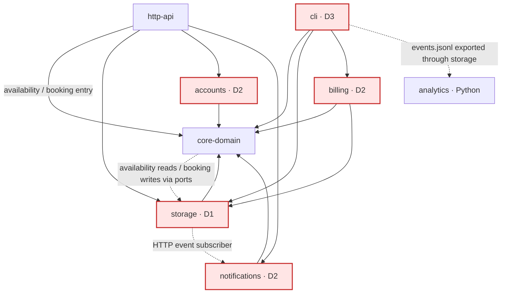

# BOUNDARIES.md

One section per milestone. Fill them in in order (the sketch before you write
anything about it, the copies next, the proposal last).

Draw Milestone 1's sketch from the code. A TA may ask where each arrow came
from.

Keep it short and specific. Point at modules, files, and callers.

---

## Milestone 1: The architecture as built

**The sketch.** One box per module. Solid arrows mean "depends on"; dashed
arrows show runtime calls, events, or file flow. Red boxes mark disagreements.

**Arrow checks.** The declared module dependencies match the diagram:
[core-domain](core-domain/pom.xml), [storage](storage/pom.xml#L18),
[accounts](accounts/pom.xml#L18), [notifications](notifications/pom.xml#L18),
[billing](billing/pom.xml#L18), [http-api](http-api/pom.xml#L18), and
[cli](cli/pom.xml#L18). Runtime calls through domain-defined store interfaces
run from `core-domain` into `storage`, opposite the source dependency arrow;
[CampusReservePlatform](http-api/src/main/java/edu/cmu/cs214/campusreserve/http/CampusReservePlatform.java#L44)
injects the implementations.

For the dashed arrows, the request paths below trace domain calls into storage.
HTTP wiring
[subscribes notifications](http-api/src/main/java/edu/cmu/cs214/campusreserve/http/CampusReservePlatform.java#L56)
and [EventLogPublisher.publish](storage/src/main/java/edu/cmu/cs214/campusreserve/storage/EventLogPublisher.java#L36)
appends before calling subscribers. CLI
[export-events](cli/src/main/java/edu/cmu/cs214/campusreserve/cli/commands/ExportEventsCommand.java#L43)
calls storage's [InMemoryEventLog.writeTo](storage/src/main/java/edu/cmu/cs214/campusreserve/storage/InMemoryEventLog.java#L63);
Python [load_events](analytics/campusreserve_analytics/events.py#L272) reads the file.

**Request paths.**

- **Availability:** HTTP routing reaches
  [RoomsHandler.availability](http-api/src/main/java/edu/cmu/cs214/campusreserve/http/RoomsHandler.java#L71),
  which looks up the room through `RoomCatalog` and asks `AvailabilityService`
  for free intervals and utilization. Its
  [busyIntervals](core-domain/src/main/java/edu/cmu/cs214/campusreserve/core/service/AvailabilityService.java#L39)
  calls `BookingStore.findConflicts`, implemented in `storage` (D1).
- **Booking:** [BookingsHandler.create](http-api/src/main/java/edu/cmu/cs214/campusreserve/http/BookingsHandler.java#L54)
  authenticates through [RequestAuth](http-api/src/main/java/edu/cmu/cs214/campusreserve/http/RequestAuth.java#L27)
  and `accounts`, then calls
  [BookingService.requestBooking](core-domain/src/main/java/edu/cmu/cs214/campusreserve/core/service/BookingService.java#L91).
  The domain checks rules and user limits, then checks room conflicts through
  `ConflictChecker` and `TimeInterval.overlaps`. It writes a confirmed booking
  and publishes an event, or writes a waitlist entry. The CLI's `book` command
  enters the same domain service with a supplied user ID (D3).

**Writes and state.** `core-domain` makes booking/waitlist decisions and writes
through store ports; `storage` holds those records and writes the event log
([BookingService](core-domain/src/main/java/edu/cmu/cs214/campusreserve/core/service/BookingService.java#L112),
[joinWaitlist](core-domain/src/main/java/edu/cmu/cs214/campusreserve/core/service/BookingService.java#L315),
[StoreRegistry](storage/src/main/java/edu/cmu/cs214/campusreserve/storage/StoreRegistry.java#L22)).
Room/user changes also go through domain services
([RoomCatalog.register](core-domain/src/main/java/edu/cmu/cs214/campusreserve/core/service/RoomCatalog.java#L25),
[UserRegistry.register](core-domain/src/main/java/edu/cmu/cs214/campusreserve/core/service/UserRegistry.java#L24)).
Accounts, notification queues, and invoices have additional owners (D2).
`http-api` and `cli` wire and invoke services; analytics reads the log and
[prints reports](analytics/campusreserve_analytics/cli.py#L75).

**Where the sketch and `ARCHITECTURE.md` disagree, and how the code settles it.**

| Marker | Document claim | Source check and finding |
|---|---|---|
| **D1: overlap logic** | The [booking drawing](ARCHITECTURE.md#L84) calls `TimeInterval.overlaps` the only overlap implementation. | Availability reaches [InMemoryBookingStore.findConflicts](storage/src/main/java/edu/cmu/cs214/campusreserve/storage/InMemoryBookingStore.java#L55), which directly compares both intervals' endpoints. Booking writes use [ConflictChecker](core-domain/src/main/java/edu/cmu/cs214/campusreserve/core/policy/ConflictChecker.java#L29), which calls `overlaps`. The current predicates agree, but there are two implementations. This also contradicts `AGENTS.md` rule 3. |
| **D2: state ownership** | [What is in memory](ARCHITECTURE.md#L193) says `StoreRegistry` builds a full set of stores. | [InvoiceService.standard](billing/src/main/java/edu/cmu/cs214/campusreserve/billing/InvoiceService.java#L61) separately creates `InMemoryInvoiceStore`. [HTTP wiring](http-api/src/main/java/edu/cmu/cs214/campusreserve/http/CampusReservePlatform.java#L52) separately creates the account directory, token service, and outbox. Their state lives in [AccountDirectory](accounts/src/main/java/edu/cmu/cs214/campusreserve/accounts/AccountDirectory.java#L24), [TokenService](accounts/src/main/java/edu/cmu/cs214/campusreserve/accounts/TokenService.java#L31), and [InMemoryOutbox](notifications/src/main/java/edu/cmu/cs214/campusreserve/notifications/InMemoryOutbox.java#L23), outside `StoreRegistry`. |
| **D3: CLI authentication** | [Booking a room](ARCHITECTURE.md#L101) says the handler or command authenticates the caller. | [BookingCommands.Book.run](cli/src/main/java/edu/cmu/cs214/campusreserve/cli/commands/BookingCommands.java#L41) reads `--user` and passes it directly into `BookingRequest`. [CliContext.inMemory](cli/src/main/java/edu/cmu/cs214/campusreserve/cli/CliContext.java#L52) wires no accounts authentication service. HTTP authenticates; the CLI accepts a supplied identity. |

---

## Milestone 2: Run it as copies

**Stack.** [compose.yaml](compose.yaml): two API copies, nginx on port 8080,
plus k6. Run `python3 load/run.py`; it starts the stack with
`docker compose up -d --build --force-recreate --scale api=2 api proxy`, waits
for nginx, and uses fresh tokens and `--no-deps` for k6.

**Observed October 28, 2026, 23:43:25 UTC.** Both scripts saw two `X-Upstream`
addresses: `172.23.0.2:8080` and `172.23.0.3:8080`. Coverage, authentication
preconditions, and response checks passed. [Committed evidence](load/evidence.json).

| Claim / script | Threshold | Result |
|---|---|---|
| A token works on any copy — [tokens.js](load/tokens.js) | `token_accepted: rate==1` | 20 HTTP 200; 20 HTTP 401. Failed, exit 99. |
| A room slot is confirmed at most once — [double-booking.js](load/double-booking.js) | `confirmed_bookings: count>=1` and `count<=1` | Both copies confirmed `r-1`, October 29, 10:00–11:00 UTC. Failed, exit 99. |
| Same booking script, one-copy control | Same booking thresholds | One confirmation, one waitlist entry. Passed, exit 0. |

**Tokens: process-local session state.** Each platform creates its own
[TokenService](http-api/src/main/java/edu/cmu/cs214/campusreserve/http/CampusReservePlatform.java#L52).
Authentication [looks up the token locally](accounts/src/main/java/edu/cmu/cs214/campusreserve/accounts/TokenService.java#L113),
so the other copy rejects it.

**Bookings: a global invariant enforced locally.** Each process gets separate
[stores](storage/src/main/java/edu/cmu/cs214/campusreserve/storage/StoreRegistry.java#L22).
[BookingService](core-domain/src/main/java/edu/cmu/cs214/campusreserve/core/service/BookingService.java#L112)
checks and writes only its own calendar. Both see the slot as free. The script
uses different users and each copy's own token directly, avoiding the token
failure. Requests are sequential: this failure needs no timing race.

**Control checked.** The agent proposed and ran the one-copy control: sharing
one calendar waitlisted the second request; separate calendars confirmed both.
Identical code does not share memory, and nginx does not synchronize state.

---

## Milestone 3: One boundary

**Boundary.** Declare a `BookingTransaction` port in `core-domain`, implemented
by `storage` using a shared database instead of production in-memory booking
and waitlist stores. The port serializes changes to each room: acquire a
database transaction lock, read current bookings, run the existing domain
conflict check, write, and commit. Creation, modification, cancellation, and
promotion must all use it. Booking policies and overlap semantics stay in
`core-domain`; no additional business service is needed.

**Owner.** `storage` owns the authoritative booking and waitlist records.
`BookingService` makes changes through the transactional ports; HTTP handlers
call the service rather than writing records directly.

**Invariant.** No two active bookings for the same room overlap.

**Costs.** Database round trips, durable writes, contention on busy rooms, and
dependence on database availability. The transaction contract, database schema,
and new storage implementation also need maintenance; the latency impact needs
measurement.

**Unfixed.** Tokens remain process-local. Per-room locking also needs additional
coordination to prevent concurrent bookings for one user across different rooms.
